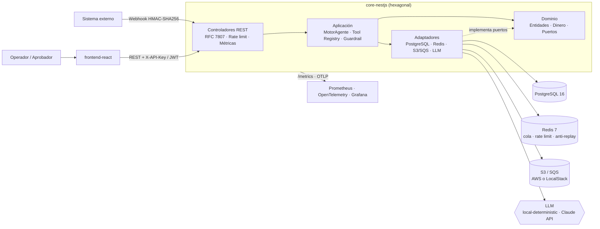
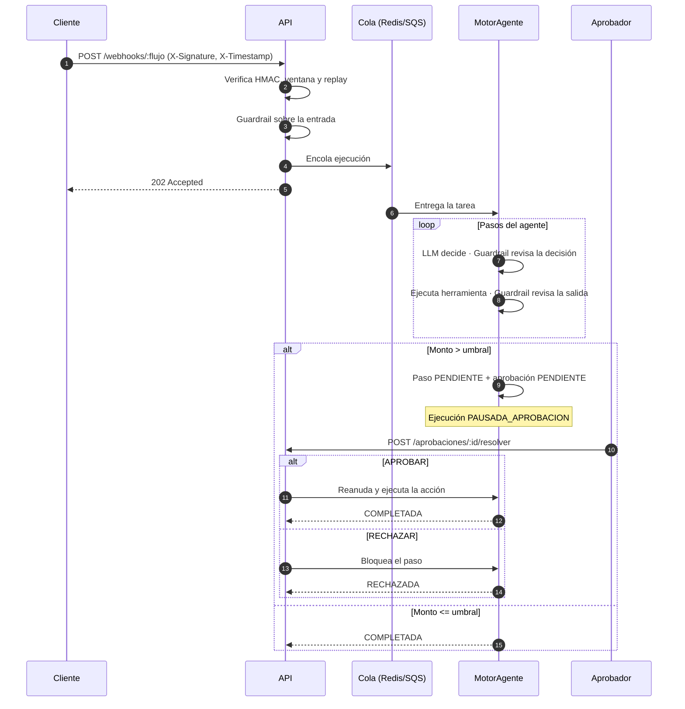
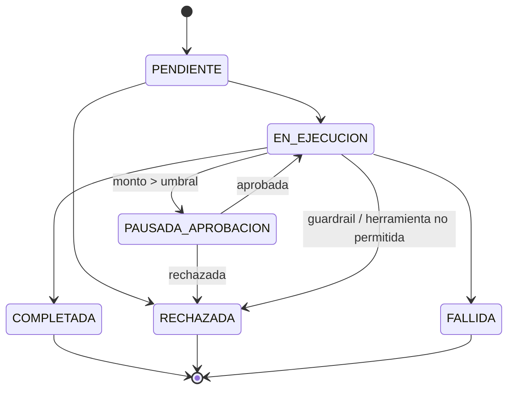
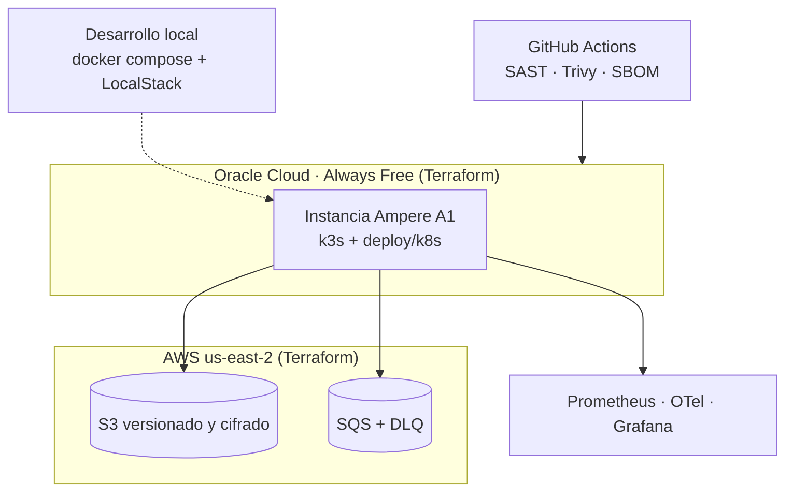

# agentic-workflow-hexagonal-platform

Plataforma empresarial de automatización de procesos comerciales y administrativos mediante **agentes de IA con Tool
Calling**, **Human-in-the-Loop**, **webhooks firmados** y **defensa OWASP** (anti-prompt-injection). Arquitectura hexagonal
sobre NestJS, consola operativa en React y despliegue endurecido con Docker, Kubernetes y Terraform (OCI Always Free + AWS).

## Qué resuelve

Un agente recibe una solicitud (por API o webhook firmado), decide paso a paso qué herramientas usar (consultar
proveedores/catálogo, validar umbral presupuestario, emitir propuesta comercial, notificar) y **se detiene para pedir
aprobación humana** cuando una acción crítica supera el umbral del flujo. Cada paso, aprobación y evento de seguridad queda
trazado y auditado.

## Arquitectura



## Flujo del agente con Human-in-the-Loop



## Estados de una ejecución



## Despliegue



## Selección del modelo de IA

El proyecto arranca **sin ninguna API Key de IA**. Desde la consola (pestaña **Modelo de IA**, rol ADMIN) se elige el proveedor
en caliente, sin reiniciar y para todas las réplicas:

| Proveedor | Requisitos | Costo |
|---|---|---|
| Determinista local (por defecto) | Ninguno | $0 |
| Ollama (modelos locales) | `docker compose --profile ollama up -d` y `docker compose exec ollama ollama pull llama3.2:3b` (o `./scripts/setup.sh --with-ollama`) | $0 |
| API de Anthropic (Claude) | API Key de Anthropic, que se guarda cifrada (AES-256-GCM) en Redis y nunca se muestra de nuevo | Pago por uso |

Los valores iniciales salen de `LLM_PROVIDER`, `OLLAMA_BASE_URL`, `OLLAMA_MODEL` y `ANTHROPIC_*`; la selección hecha en la consola
tiene prioridad. Los modelos locales pequeños pueden equivocarse al invocar herramientas: el motor valida cada decisión, aplica la
lista blanca y el guardrail, y falla de forma controlada.

## Seguridad

| Amenaza | Control |
|---|---|
| Prompt injection directa e indirecta (LLM01) | `GuardrailPromptInjection` en entrada, decisión del LLM y salida de herramientas |
| Agencia excesiva (LLM06) | Lista blanca de herramientas por flujo, validación estricta, límite de pasos |
| Acciones críticas sin supervisión | Pausa por umbral + aprobación humana de un solo uso |
| Webhooks falsificados o repetidos | HMAC-SHA256 sobre `timestamp.cuerpo`, ventana de 300 s, anti-replay en Redis |
| Acceso no autorizado | JWT o `X-API-Key` (SHA-256, tiempo constante), roles `ADMIN` / `APROBADOR` |
| Abuso | Rate limiting por IP en Redis, errores RFC 7807 sin detalles internos |
| Repudio | Tabla `auditoria_seguridad` append-only (trigger) y `X-Correlation-ID` extremo a extremo |
| Contenedores | `non-root` UID 10001, `read_only`, `tmpfs`, `cap_drop: ALL`, `no-new-privileges` |
| Red en Kubernetes | NetworkPolicies de denegación total y Pod Security Standards |

## Inicio rápido

Requisitos: Docker con Compose v2, Node.js 20 (para pruebas locales) y Git.

```bash
cp .env.example .env
# Edite .env: reemplace todos los valores "cambiar_*" por secretos propios (>= 32 caracteres) y defina API_KEYS.
docker compose up --build
```

| Servicio | URL |
|---|---|
| Consola (React) | http://localhost:5173 |
| API (NestJS) | http://localhost:3000 (`/health`, `/metrics`) |
| LocalStack | http://localhost:4566 |

Abra la consola e ingrese la API Key `ADMIN` o `APROBADOR` definida en `API_KEYS` (formato `nombre:ROL:clave`).

### Instalación automática

Un solo comando genera `.env` con secretos aleatorios, instala dependencias, ejecuta typecheck, pruebas y build,
levanta `docker compose` y corre la prueba de humo:

```bash
./scripts/setup.sh
```

Opciones: `--skip-tests`, `--skip-docker`, `--skip-smoke`, `--reset-env`, `--down` y `--clean`
(`./scripts/setup.sh --help`). Al terminar muestra las URLs y las API Keys generadas.

Cada ejecución guarda una copia trazable en `.setup/setup-YYYYMMDD-HHMMSS.log`. Si ocurre un error, el mensaje
incluye hora, estado, línea/comando y la ruta del registro. Los archivos `.setup/` están excluidos de Git.

### Prueba de humo

```bash
./scripts/smoke_test.sh
```

Verifica: webhook firmado, ejecución de herramientas, pausa por aprobación, aprobación humana y finalización, además de
rechazo humano, replay, prompt injection, RFC 7807 y métricas.

### Pruebas automatizadas

```bash
cd services/core-nestjs
npm install
npm test            # unitarias e integración (Jest + Supertest)
npm run test:e2e    # flujo extremo a extremo en memoria
```

### Pruebas de carga (k6)

```bash
k6 run -e PERFIL=smoke \
  -e WEBHOOK_SECRET=... -e ADMIN_API_KEY=... -e APROBADOR_API_KEY=... \
  load-tests/agent-load-test.js
```

Perfiles: `smoke`, `load`, `stress`. Desde una sola IP eleve `RATE_LIMIT_MAX`; de lo contrario aparecerán respuestas 429.

### Kubernetes

```bash
docker build -f docker/Dockerfile.node20 -t agentic/core-nestjs:local services/core-nestjs
docker build -f docker/Dockerfile.frontend-node20 -t agentic/frontend-react:local frontend-react
kubectl apply -k deploy/k8s
```

Los secretos de `deploy/k8s/config.yaml` son valores de desarrollo (prefijo `CAMBIAR-`): reemplácelos antes de cualquier uso real.

### Infraestructura como código

```bash
cd infra/terraform
terraform init
terraform plan   # requiere credenciales de OCI y AWS y las variables de variables.tf
```

## API principal

| Método | Ruta | Rol | Descripción |
|---|---|---|---|
| `GET` | `/health` | — | Salud de PostgreSQL y Redis |
| `GET` | `/metrics` | — | Métricas Prometheus |
| `POST` | `/auth/token` | API Key | Emite un JWT |
| `POST` | `/ejecuciones` | ADMIN / APROBADOR | Inicia una ejecución (`202`) |
| `GET` | `/ejecuciones` | ADMIN / APROBADOR | Lista ejecuciones |
| `GET` | `/ejecuciones/:id/traza` | ADMIN / APROBADOR | Pasos, aprobaciones y resultado |
| `GET` | `/aprobaciones/pendientes` | ADMIN / APROBADOR | Bandeja Human-in-the-Loop |
| `POST` | `/aprobaciones/:id/resolver` | APROBADOR / ADMIN | `APROBAR` o `RECHAZAR` |
| `POST` | `/webhooks/:flujo` | Firma HMAC | Ingesta de webhooks firmados |
| `POST` | `/webhooks/simulador/firmar` | ADMIN | Firma un cuerpo (Simulador) |

Los errores usan `application/problem+json` (RFC 7807) e incluyen `correlationId`.

## Estructura del repositorio

```
.
├── services/core-nestjs/     # Núcleo hexagonal (domain · application · infrastructure)
├── frontend-react/           # Consola: bandeja HITL, trazador, simulador
├── db/postgres/init.sql      # Esquema y datos semilla
├── infra/                    # LocalStack y Terraform (OCI + AWS)
├── deploy/k8s/               # Manifiestos Kubernetes (Kustomize)
├── load-tests/               # Pruebas k6
├── scripts/smoke_test.sh     # Prueba de humo E2E
├── docker/ · monitoring/ · .github/workflows/   # Blueprint DevSecOps heredado
└── docs/adr/                 # Decisiones de arquitectura
```

## Decisiones de arquitectura

- [ADR-0001: Arquitectura Hexagonal en NestJS](docs/adr/0001-arquitectura-hexagonal-nestjs.md)
- [ADR-0002: Human-in-the-Loop y defensa Anti-Prompt Injection](docs/adr/0002-human-in-the-loop-y-defensa-prompt-injection.md)
- [ADR-0003: Despliegue híbrido OCI Always Free + AWS](docs/adr/0003-despliegue-hibrido-oci-aws.md)

## Limitaciones conocidas

- El guardrail es heurístico (patrones): reduce el riesgo, no lo elimina.
- No hay expiración automática de aprobaciones pendientes.
- Un solo nodo en OCI Always Free implica ausencia de alta disponibilidad y de respaldos automatizados.
- LocalStack y los secretos de desarrollo son solo para entornos de prueba.

## Licencia

MIT
